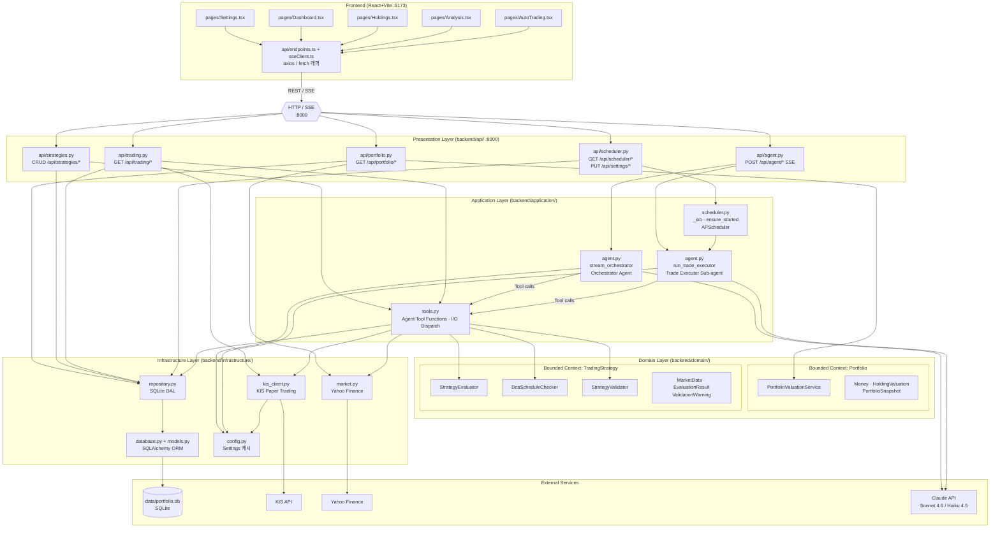
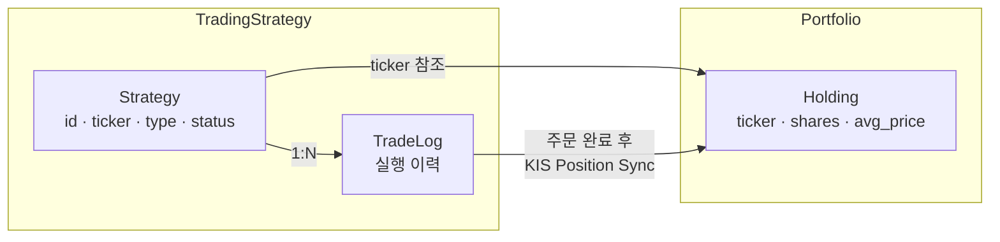
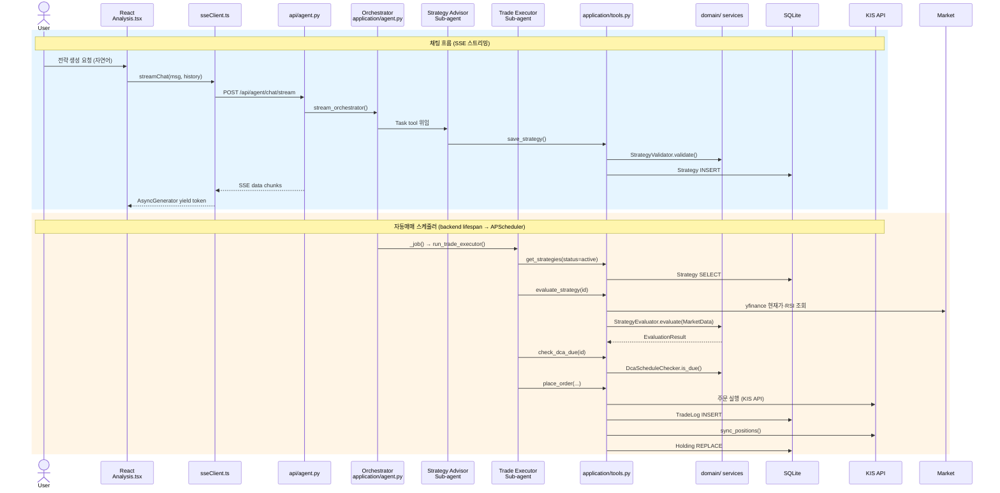
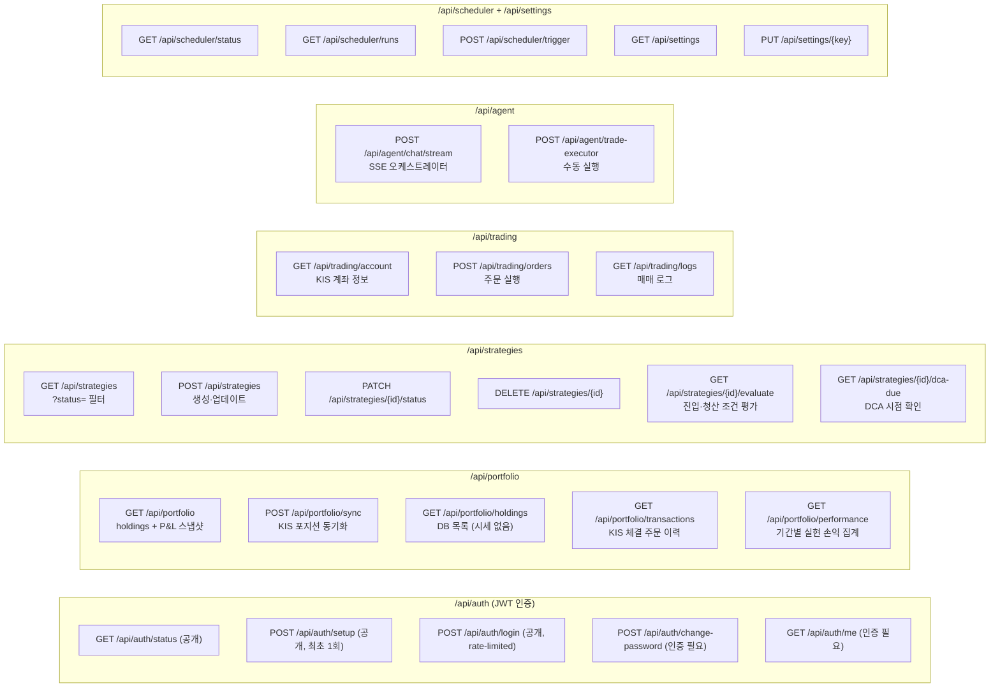
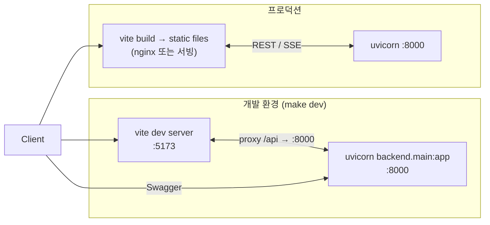

# Architecture: DDD 4계층 + Backend/Frontend Split

---

## 전체 레이어 구조

---

## 도메인 간 관계

---

## Agent 실행 흐름 (채팅 + 자동매매)

---

## REST API 엔드포인트 목록

---

## 코드 레벨 검증 vs 프롬프트 지시

아래 비즈니스 규칙은 **반드시 코드로 검증**해야 한다. LLM 프롬프트 지시에만 의존하면 안 된다:

| 규칙 | 코드 검증 위치 | 이유 |
|------|--------------|------|
| 시장 개장 시간 | `tools.py::_place_order_locked()` | LLM이 시간대 계산을 틀릴 수 있음, 장 외 주문 시 실제 손실 가능 |
| max_position 초과 | `tools.py::evaluate_strategy()` + `_place_order_locked()` | DB 조회 결과에 기반한 정확한 수치 비교 필요 |
| exit_triggered 보유 전제 | `domain/services.py::StrategyEvaluator.evaluate()` | 보유 없는 공매도 방지 |
| 주문 수량/가격 유효성 | KIS API (브로커 측 검증) | 잘못된 주문은 실제 자금 손실 초래 |

**반면** 다음은 프롬프트 지시로 충분하다:
- 응답 포맷 (마크다운 테이블, 한국어 등)
- 신호 강도 판단 (signal_score 기반 매수 보류 권고)
- 분석 관점 선택 (어떤 지표를 우선 언급할지)
- 실행 이력 기반 패턴 분석

---

## 프로세스 구성

